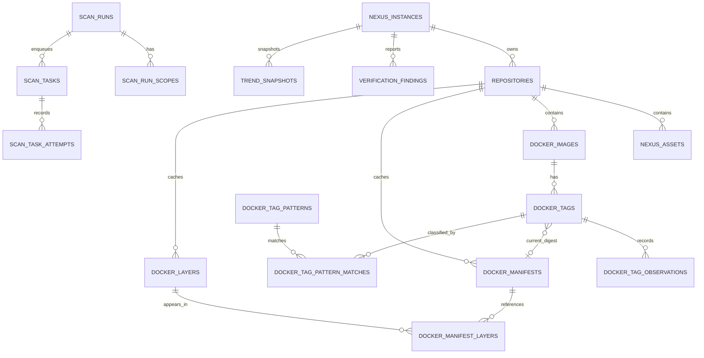
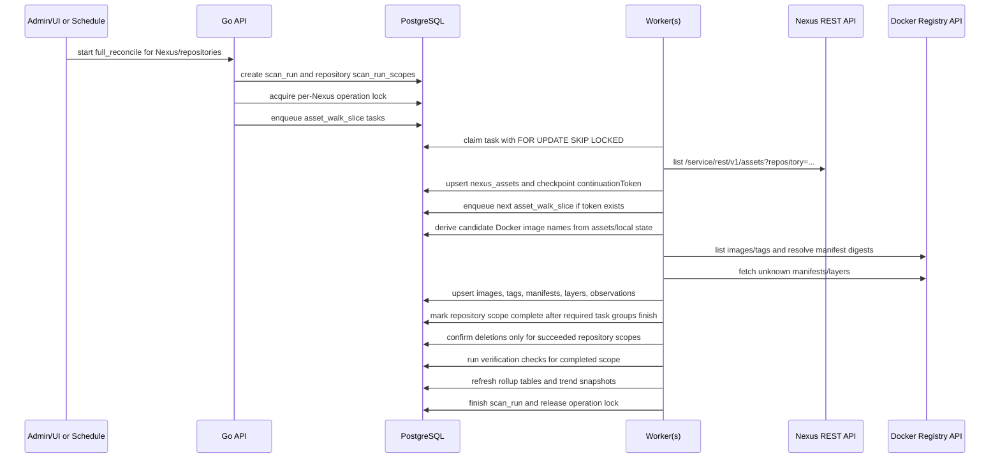
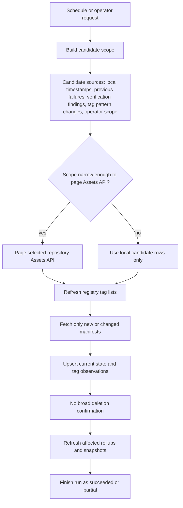
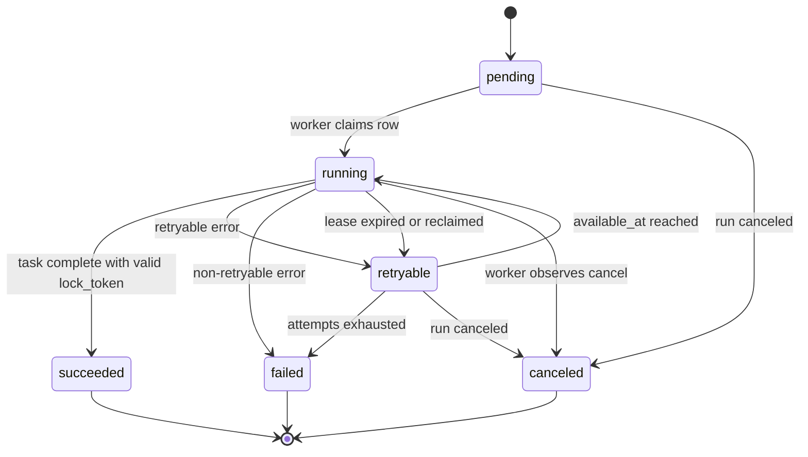
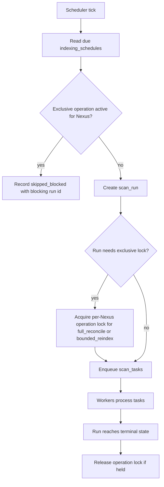
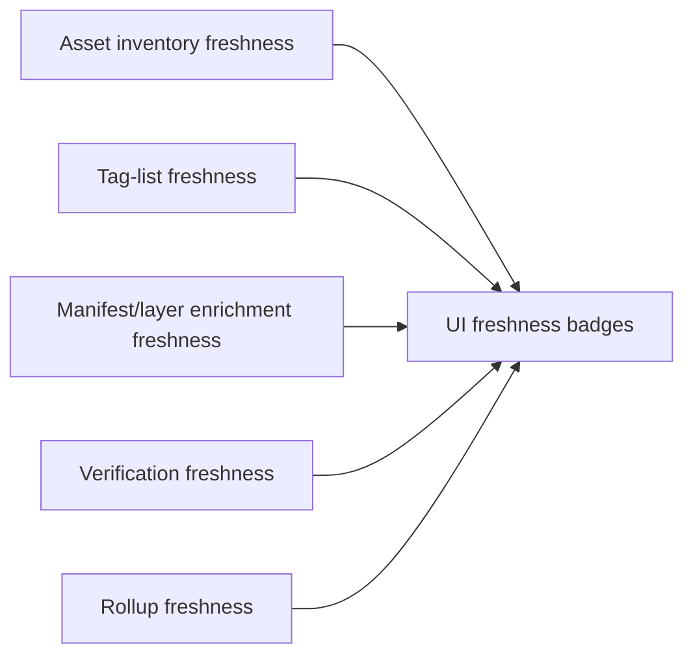
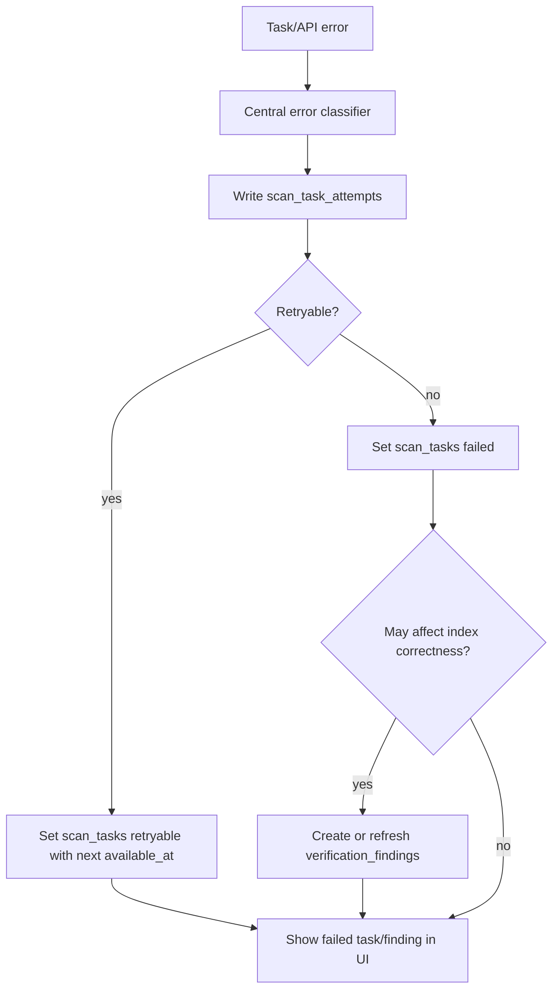
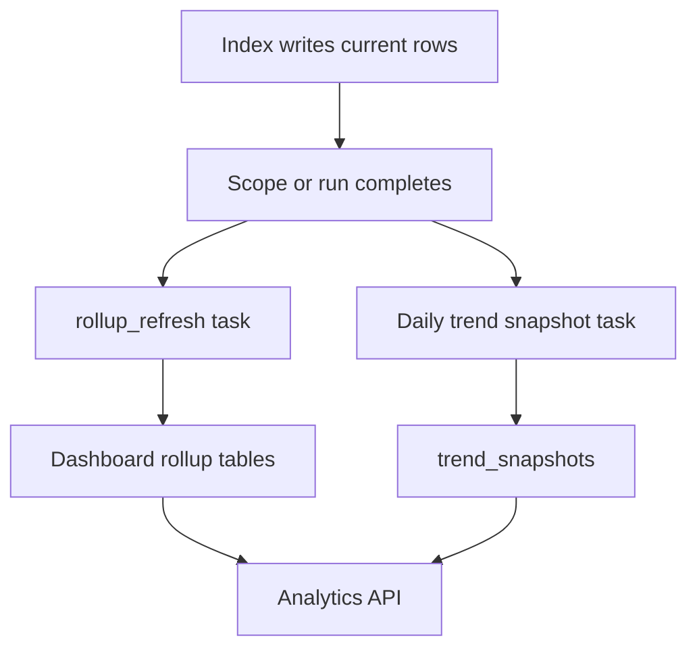

# Nexus Lens Flow Design

This document explains the simplified v1 architecture and indexing flows for Nexus Lens. It is intended to be read beside `nexus-lens-design.md` and `nexus-lens-indexing-queue-design.md`.

## V1 Architecture

V1 keeps the runtime small: API, worker, scheduler, PostgreSQL, and Nexus. PostgreSQL is the source of truth for application state, indexed artifact state, queue state, checkpoints, rollups, verification findings, and users.

```mermaid
flowchart LR
  UI[TypeScript UI]
  API[Go API pod]
  Worker[Go worker pod(s)]
  Scheduler[Scheduler loop or CronJob tick]
  PG[(PostgreSQL)]
  Nexus[Nexus Repository 3.88+]
  Registry[Nexus Docker Registry API]
  Prom[Prometheus]

  UI -->|/api/v1| API
  API -->|read/write app state| PG
  API -->|manual run requests| PG
  Scheduler -->|due schedules| PG
  Worker -->|claim scan_tasks| PG
  Worker -->|REST assets/repos/status/tasks| Nexus
  Worker -->|tags/manifests/layers| Registry
  Worker -->|index results/checkpoints/errors| PG
  Prom -->|scrape metrics| API
  Prom -->|scrape metrics| Worker
```

Out of v1:

- No custom Kubernetes operator.
- No packaged PostgreSQL.
- No Redis, Valkey, or external task queue.
- No webhook receiver/storage/API.
- No blob-store disk or object-store scanning.
- No cleanup execution.
- No deep Nexus component model for Docker.

## Simplified V1 Index Model

The v1 index is Docker/OCI-first. Nexus assets provide repository inventory and timestamps. Registry manifests provide tag-to-digest truth, logical image size, layer sharing, and reclaimable-byte estimates.



Deferred models:

- Generic `storage_objects`.
- Generic `source_observations`.
- `docker_tag_versions` interval history.
- Separate `registry_digest_cache`.
- Separate `index_warnings`.
- Webhook event storage.
- Generic artifact/package model for non-Docker formats.

`DOCKER_TAGS.current_digest` is a logical relationship to `DOCKER_MANIFESTS.digest`; it does not need to be a strict foreign key in v1 because manifests may be enriched asynchronously.

## Full Reconcile Flow

Full reconcile is the authoritative operation for broad drift detection and deletion confirmation. V1 deletion authority is repository-scoped.



Deletion guardrails:

- Recent sync never marks broad deletions.
- Bounded reindex never marks broad deletions.
- Full reconcile can confirm deletions only after a repository scope is complete, cursor-exhausted, and error-free.
- Invalid cursors, cancellation, budget exhaustion, or partial scope failure block deletion confirmation for that scope.

## Recent Sync and Bounded Reindex

Recent sync and bounded reindex are candidate refreshes. They make the index fresher without pretending Nexus exposes a complete changed-since feed.



Candidate refresh results should be labeled as partial unless the run completed a full authoritative repository scope.

## PostgreSQL Queue Flow

V1 uses PostgreSQL as the task queue. This keeps scan state, queue state, retries, checkpoints, and indexed data in one datastore.



Claiming rules:

- Workers claim with `FOR UPDATE SKIP LOCKED`.
- Claims are short transactions.
- Network work happens outside the claim transaction.
- `lease_expires_at` and `lock_token` prevent stale workers from writing late completion.
- Every failure writes a compact latest error on `scan_tasks` and detailed attempt history in `scan_task_attempts`.

## Schedule and Operation Lock Flow

Schedules are app-managed rows in PostgreSQL. The scheduler only decides what is due and enqueues work; it does not perform indexing inline.



Recent sync can be skipped when an exclusive operation is active. Full reconcile and bounded reindex must be mutually exclusive per Nexus instance.

## Data Freshness Flow

Freshness is tracked separately because each source has a different cost and reliability profile.



Storage views should distinguish:

- Nexus asset bytes from REST asset `fileSize`.
- Docker logical bytes from manifest/layer descriptors.
- Estimated reclaimable bytes from Docker layer sharing analysis.

## Error and Verification Flow

Errors are classified once in Go and stored in structured fields. Correctness-impacting errors become verification findings.



Operators should be able to answer:

- Which Nexus/repository/image/tag failed.
- Which cursor, page, digest, or route failed.
- Whether the error is retryable.
- When the next retry will happen.
- Which scan run and task attempt contain the details.
- Which data remains trustworthy.

## Rollup and Snapshot Flow

V1 prefers explicit rollup tables and daily snapshots over materialized views.



Materialized views can be added later if profiling shows they are better than rollup tables for specific dashboards.

## Later Extension Points

These can be added after v1 without changing the core source-of-truth model:

- Webhook-assisted candidate discovery.
- Non-Docker format indexers.
- Generic artifact/package model.
- Cleanup policy simulation.
- Destructive cleanup execution.
- Cross-repository digest cache.
- Materialized views for expensive dashboards.
