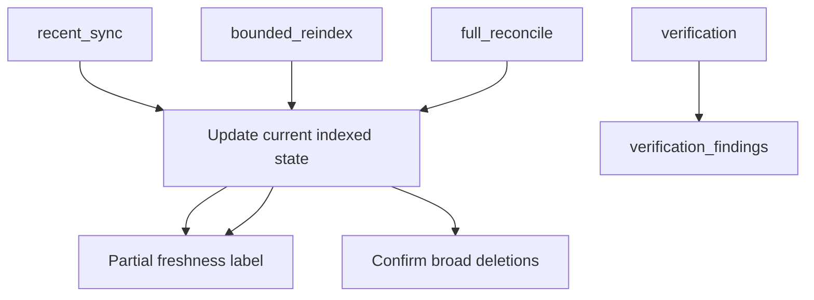
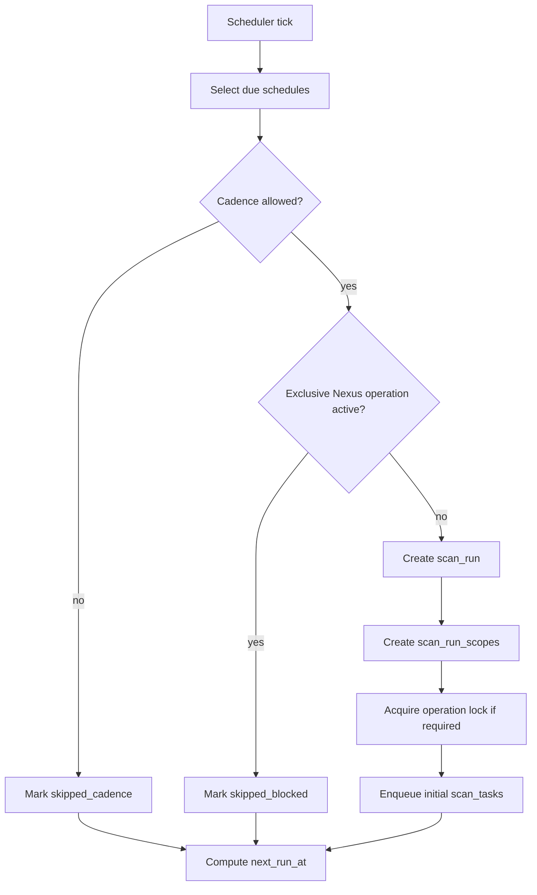
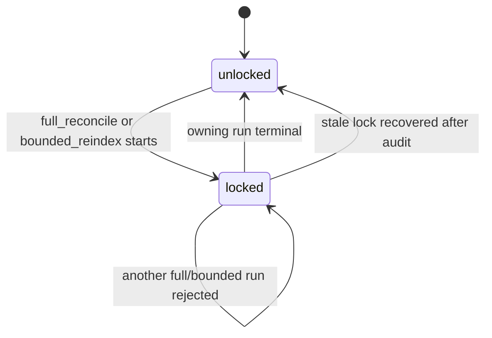
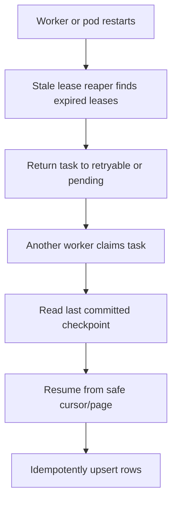
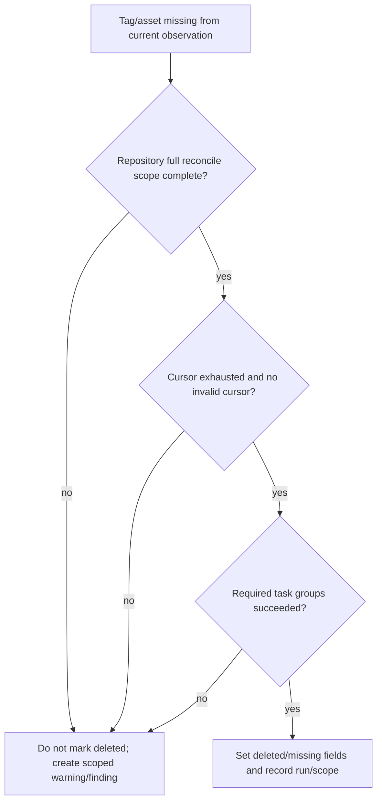

# Nexus Lens Indexing and Job Queue Design

This document defines the v1 indexing execution model and PostgreSQL-backed job queue. It expands the flow diagrams in `nexus-lens-flow-design.md` and the schema/phase plan in `nexus-lens-design.md`.

## Goals

- Keep indexing correct, resumable, and easy to debug.
- Use PostgreSQL as the single durable source of truth for run state, queue state, checkpoints, errors, and indexed rows.
- Avoid Redis, Valkey, River, Asynq, Temporal, or any external queue in v1.
- Respect Nexus rate limits and avoid surprise broad scans.
- Make deletion confirmation conservative and auditable.
- Keep scheduled work predictable: recent sync has a bounded 15-60 minute cadence; broad/heavy work is capped.

## Run Types and Schedule Policy

| Run type | Purpose | Default cadence | Schedule cap | Deletion authority |
| --- | --- | --- | --- | --- |
| `recent_sync` | Refresh likely changed repositories/images from local hints, previous failures, verification findings, and asset timestamps | Every 30 minutes by default | Configurable 15-60 minute cadence | No broad deletion authority |
| `bounded_reindex` | Refresh a specific whole-day time window or operator-selected scope | Weekly over previous 7 days | At most once per day per Nexus by default | No broad deletion authority |
| `full_reconcile` | Walk selected repositories and confirm broad drift/deletions | Weekly, monthly, or manual by scale | At most once per day per Nexus by default | Yes, repository-scoped only |
| `verification` | Compare sampled/scoped indexed records back to Nexus/registry | Daily or after selected runs | Can skip during exclusive operations | Creates findings, no deletion authority |
| `trend_snapshot` | Write compact aggregate daily metrics | Daily | Once per day per Nexus/scope | None |
| `rollup_refresh` | Refresh dashboard rollup rows for completed scopes | Triggered by completed runs/scopes | Internal task, deduped by scope | None |

Schedule rules:

- Scheduled recent sync should default to every 30 minutes and allow 15-60 minute schedules.
- Scheduled bounded reindex and full reconcile should not run more often than once per day per Nexus by default.
- Default bounded reindex should remain weekly over the previous 7 whole days unless an operator changes it.
- Full reconcile should default to weekly, monthly, or manual depending on Nexus scale.
- Missed scheduler ticks are skipped in v1; do not queue a backlog of catch-up runs after downtime.
- A blocked scheduled run records `skipped_blocked` with the blocking run ID.
- Manual operator runs may bypass cadence limits, but still respect per-Nexus operation locks and confirmation prompts.

## Authority Model



Authority rules:

- Nexus REST APIs and Docker Registry APIs are source-system truth.
- PostgreSQL is Nexus Lens' durable local truth.
- Recent sync and bounded reindex can add/update records and verify explicit subjects.
- Only a completed repository-scoped full reconcile can confirm broad missing-tag or missing-asset deletion.
- A cursor restart, invalid cursor, canceled run, budget pause, failed task group, or partial scope blocks deletion confirmation for that repository scope.

## Core Tables

V1 queue execution is intentionally simple:

- `indexing_schedules`: app-managed schedule definitions and next due time.
- `scan_runs`: one row per run, user/API/scheduler trigger, status, phase, counters, structured latest error.
- `scan_run_scopes`: repository-level authority boundaries for full reconcile; narrower scopes for bounded reindex/verification.
- `scan_tasks`: hot queue table claimed by workers.
- `scan_task_attempts`: append-only attempt history and detailed errors.
- `index_checkpoints`: resumable cursor and high-watermark state.
- `nexus_operation_locks`: one exclusive operation lock per Nexus instance.
- `verification_findings`: drift, stale data, blocked deletion, and operator-facing warnings.

Do not create a second queue system in v1. The queue rows and indexed state live in the same database so enqueue/result/checkpoint writes can be made transactionally.

## Scheduler Loop



Scheduler implementation notes:

- Use a short-lived scheduler loop or Kubernetes CronJob tick.
- The scheduler enqueues work only; it never performs network scans inline.
- Use a PostgreSQL advisory lock so only one scheduler instance processes due schedules at a time.
- Schedule processing should be idempotent. A repeated tick should not create duplicate active runs for the same due schedule.
- `next_run_at` is updated even when a run is skipped, unless the schedule itself is invalid.

## Operation Locks

Operation locks protect Nexus instances from conflicting broad index work.



Lock rules:

- `full_reconcile` and `bounded_reindex` acquire an exclusive per-Nexus lock.
- `recent_sync` does not acquire an exclusive lock, but it should not start while one exists unless explicitly configured as low-impact.
- `verification` and `trend_snapshot` should skip or run against the last completed state; they should not compete with active exclusive operations by default.
- Stale locks are recoverable only after checking the owning run, task leases, and worker heartbeats.

## Task Model

Task granularity should balance resume precision against queue overhead.

Core task types:

- `asset_walk_slice`: walk up to `maxPagesPerTask` Assets API pages for one repository.
- `asset_detail_batch`: fetch details for assets missing required fields.
- `image_tag_list`: list tags for one image/repository through the Docker Registry API.
- `manifest_fetch_batch`: fetch or verify up to N uncached manifest digests.
- `blob_head_batch`: fetch config/layer descriptor details only when manifest descriptors are insufficient.
- `tag_classification_batch`: classify tags against enabled tag patterns.
- `rollup_refresh`: refresh rollup rows for a completed scope.
- `verification_sample`: compare selected indexed records back to Nexus/registry.

Task key rules:

- `task_key` must identify the logical unit of work inside a run.
- Use `unique (scan_run_id, task_type, task_key)` for idempotent enqueue.
- Avoid millions of tiny tasks when page-sized or batch-sized tasks provide enough resume precision.
- Do not put large mutable JSONB payloads in hot claim predicates.

## Worker Claim and Completion

```mermaid
sequenceDiagram
  participant W as Worker
  participant PG as PostgreSQL
  participant NX as Nexus/Registry

  W->>PG: claim pending/retryable tasks with FOR UPDATE SKIP LOCKED
  PG-->>W: task rows with lock_token
  W->>NX: perform bounded network work outside transaction
  W->>PG: write indexed rows/checkpoints/attempt result
  W->>PG: complete task where lock_token matches
  PG-->>W: zero rows means lease lost; stop writing for that task
```

Claim rules:

- Claim in small batches, usually 1-50 tasks depending on cost class.
- Keep claim transactions short.
- Denormalize `nexus_instance_id` and `cost_class` onto `scan_tasks` so workers claim only work they can currently execute.
- Respect per-Nexus admission control before claiming expensive work.
- A throttled or circuit-open Nexus should not let workers claim tasks that will only sleep or fail.

Completion rules:

- Every task completion must verify the current `lock_token`.
- A zero-row completion update means the lease was lost or reclaimed.
- A worker that lost its lease must not assume its results were accepted unless the result write and completion were part of a valid lock-token transaction.

## Checkpoints and Resume

Checkpoint rules:

- Commit Nexus continuation tokens only after the page has been processed.
- Treat continuation tokens as intra-run cursors, not durable long-term cursors.
- If a continuation token is invalid or stale, restart the repository walk from the beginning.
- Mark the affected scope `invalid_cursor_seen` and block deletion confirmation until a clean cursor-exhausted pass completes.
- Registry tag list progress is checkpointed by repository/image and page/cursor when supported.
- Manifest/layer rows are immutable by digest and can be reused across runs.

Resume behavior:



## Rate Limits and Admission Control

Nexus Lens should rate-limit before making requests, not just after receiving errors.

Control dimensions:

- Nexus instance.
- API surface: REST asset list/detail, registry tag list, registry manifest fetch, registry blob/config HEAD.
- Cost class: `asset_list`, `asset_detail`, `registry_tag_list`, `registry_manifest`, `registry_blob`, `db_rollup`, `verification`.
- Worker concurrency.

Admission rules:

- Workers should claim only tasks whose Nexus instance and cost class have available capacity.
- `429`, `503`, timeouts, and connection errors reduce capacity through backoff/circuit-breaker state.
- Capacity state should be visible in the UI so slow indexing is understandable.

## Error Handling

Each task attempt writes structured error fields:

- `error_code`
- `error_class`
- `error_message`
- `error_details`
- retry decision
- next retry time
- Nexus route/status/request ID when available
- SQLSTATE when available
- checkpoint/cursor context

Retry rules:

- Retryable errors become `retryable` with `available_at`.
- Non-retryable errors become `failed`.
- Attempt exhaustion becomes `failed`.
- Lost leases are not Nexus failures; classify them separately.
- Correctness-impacting errors create or refresh `verification_findings`.

## Deletion Confirmation

Deletion confirmation is intentionally conservative.



Recent sync and bounded reindex may verify an explicit subject, but they must not infer broad deletion outside their scope.

## Retention

Default retention:

- Successful scan runs/tasks: 14-90 days depending on row type.
- Failed runs/tasks/attempts: 90 days.
- Open verification findings: keep until resolved or dismissed.
- Resolved verification findings: 180 days.
- Trend snapshots: 365 days.

Retention jobs:

- Run in small batches.
- Use advisory locks.
- Avoid deleting active runs, active tasks, open findings, or checkpoints required for resume.

## Observability

Required views:

- Active runs and phases.
- Queue depth by status, task type, Nexus instance, and cost class.
- Oldest pending task age.
- Running tasks with worker ID, pod name, attempt, heartbeat age, and progress label.
- Retryable/failed tasks with error class and next retry time.
- Stale leases reclaimed.
- Per-Nexus throttle/backoff/circuit-breaker state.
- Last successful recent sync, bounded reindex, full reconcile, verification, and trend snapshot.

Metrics should keep labels low-cardinality. High-cardinality detail belongs in PostgreSQL and structured logs.
